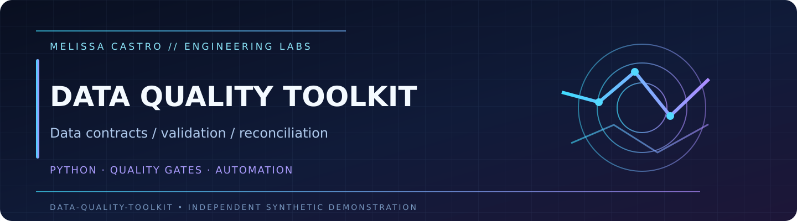

<p align="center"></p>
<p align="center"><a href="https://github.com/Dicureck/data-quality-toolkit/actions/workflows/ci.yml"></a>   </p>

# Data Quality Toolkit

**Testable data contracts, explainable validation failures, and multiplicity-aware reconciliation.** A compact, independent Python toolkit for detecting invalid rows, duplicates, schema drift, and silent mismatch between datasets.

> All examples are fictional. This public project does not ingest, connect to, or publish any client data.

## Fictional sample outputs

Review the [clean fixture](examples/clean.csv), [deliberately invalid fixture](examples/dirty.csv), and [JSON evidence report](examples/quality_report.json). All values are invented and generated by `demo`.

## Quick start

```bash
python -m venv .venv
# Activate your Python virtual environment.
python -m pip install -e '.[dev]'
python -m pytest -q
python -m data_quality_toolkit demo --out-dir build/demo
python -m data_quality_toolkit audit build/demo/clean.csv
python -m data_quality_toolkit reconcile build/demo/clean.csv build/demo/dirty.csv
```

The final command intentionally returns exit code **2** because the examples contain fabricated problems; this is the correct fail-closed behavior. `build/demo/quality_report.json` includes the detailed findings and multiset reconciliation summary.

## Data pipeline

```text
Synthetic fixture generator
           ↓
   CSV schema + value rules  →  row-level errors / exit code
           ↓
   Row fingerprints + Counter
           ↓
   Missing / extra / duplicate reconciliation
           ↓
   JSON evidence for a downstream quality gate
```

## Evidence and limitations

| File | Purpose |
|:--|:--|
| `src/data_quality_toolkit/core.py` | Contract validation, deterministic sample fixtures, SHA-256 row fingerprints |
| `src/data_quality_toolkit/__main__.py` | CLI (`demo`, `audit`, `reconcile`) with meaningful exit codes |
| `tests/` | Contract, multiplicity, negative cases and output behavior |
| [Data contract](docs/contracts.md) | Columns, accepted values, required semantics |
| [Reconciliation design](docs/reconciliation.md) | Bag semantics and normalization caveats |
| [Automation blueprint](docs/automation-blueprint.md) | Safe, approval-gated internal process design |
| [Engineering decisions](docs/engineering-decisions.md) | Tradeoffs and extension boundaries |

## Professional relevance

Data validation precedes dashboards, SQL optimization, and database migration: a faster report is not useful if it silently drops or duplicates records. This lab demonstrates how to protect integrity with explicit, independently testable contracts.

Created by **Melissa Castro** as original portfolio code. MIT license. Not an employer/customer artifact.
